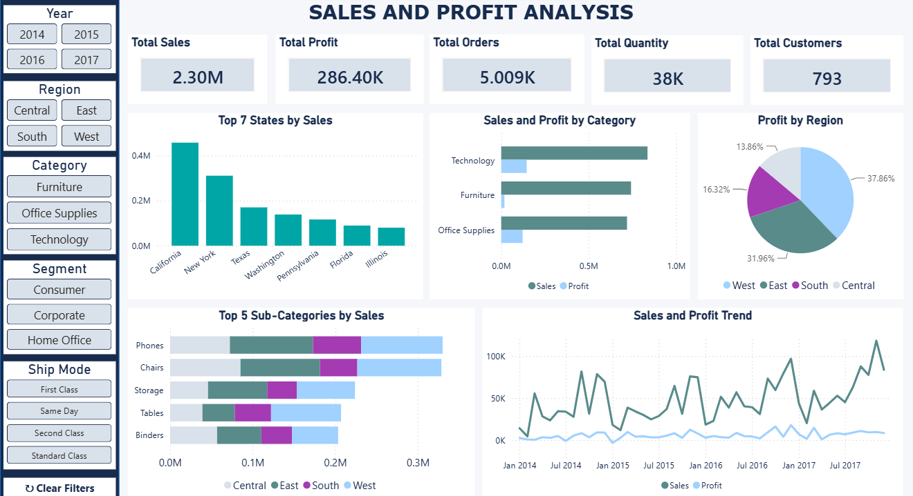

# Amazon Sales Analysis Dashboard

## Project Overview
An interactive Power BI dashboard developed to analyze Amazon sales performance and identify trends in sales and profitability.

## Tools & Technologies
- Power BI
- Power Query

## Key Features
- KPI cards for key business metrics.
- Interactive slicers for dynamic filtering.
- Sales and profit trend analysis.
- Product-wise and regional sales analysis.
- Interactive charts for data visualization.

## Data Preparation
Used Power Query for data cleaning and transformation to prepare the dataset for analysis.

## Dashboard Preview

## Project File
- [Download Power BI Dashboard](amazon_sales_dashboard.pbix)
